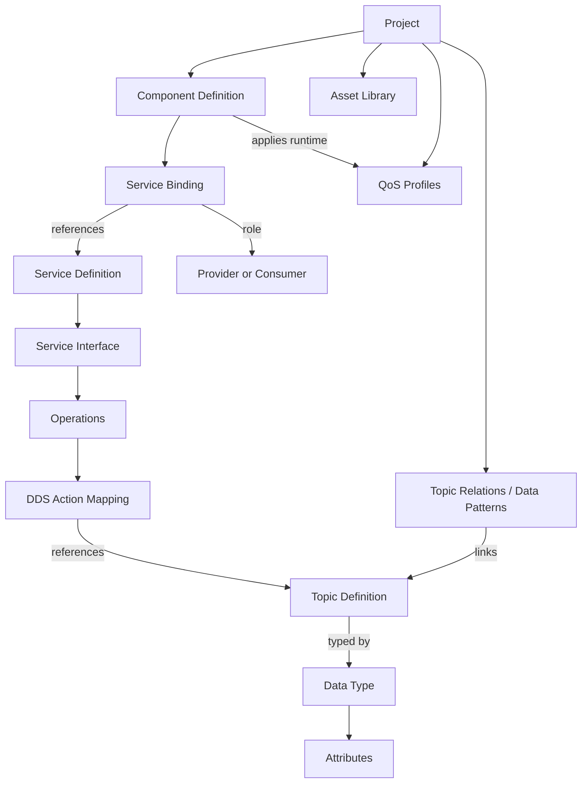

# 02. 도메인 계층 / ICD 기반 용어 정의

## 합의된 UI 용어

| UI/ICD 우선 표기 | 뜻 | 주의 |
|---|---|---|
| Component | Service Provider 및/또는 Consumer를 구현·사용하는 논리 단위 | DLL/SO와 반드시 1:1인 것은 아님 |
| Service | UMAA의 기능 계약 | Component가 복사 소유하지 않고 참조 |
| Service Interface | Operations의 계약을 나타내는 Interface | Component Port/Service Binding과 동일 개념 아님 |
| Operation | set/query/report/cancel 등 서비스의 행위 | Topic과 1:1 강제 금지 |
| Service Binding | Component와 Service의 Provider/Consumer 관계 | Studio의 관계 객체 |
| Component Port | Component에서 Service Interface를 제공/소비하는 논리 접점 | DDS Endpoint와 동일하지 않음 |
| Flow Control | Command / Response 또는 Request / Reply | Report/Status는 여기에 속하지 않음 |
| Service Category | Control, Config, Specs, Status / Report 등 UI 분류 | 공식 필수 UMAA enum 아님 |
| Topic | DDS 토픽, ICD의 Topic 필드 | 이름이 Data Type과 동일해도 별도 객체 |
| Data Type | ICD의 Data Type, Message Definition의 타입 | UI에서 MessageType 대신 우선 표기 |
| Attribute | Data Type의 멤버 | 내부 code field와 UI 명칭 분리 가능 |
| DDS Mapping | Operation의 subscribe/publish/dispose 등 DDS 동작 연결 | Query/Cancel은 Topic 새 발행이 아닐 수 있음 |
| QoS Profile | DDS 정책을 재사용하는 설정 Asset | QoS 전체 정책/벤더 적용 구현 아님 |
| Data Patterns | Large Collections, Generalization/Specialization | 패턴은 Type·Topic·QoS·동기화 요구를 가로지름 |
| Build Target / Artifact | C++ 빌드 산출물 | UMAA 표준 Component의 하위 UML 클래스가 아님 |

## 정식 관계(개념적) — 저장 모델과 탐색 트리 구분

**아래 연결은 자산 참조이며, `Data Type`이 Component 안으로 물리적으로 복제되는 계층이 아니다.** 같은 Topic/Type을 여러 Service/Component에서 재사용한다.

## Flow Control / Report 구분

- **Command / Response**: Service Consumer가 Command를 발행하고 Provider가 Ack/CommandStatus/ExecutionStatus 등으로 응답. 명령 추적 및 종료·취소·정리 규칙은 ICD §5.1.
- **Request / Reply**: Provider의 보고 데이터에 대한 요청/응답. **Query Data가 없는 경우** Query는 별도 요청 Topic 발행이 아니라 Report Topic 구독인 경우가 많음(§5.2).
- **Status / Report Service**: `GlobalPoseStatus`, `HealthReport` 등 상태·정보 제공 목적 Service의 **이름 성격**.
- **Report Operation**: `reportGlobalPose`, `reportGlobalVectorCommandStatus` 등 개별 Operation. Command/Response Service 내부에도 존재함.

## Data Patterns

- **Large Collections / Large Set / Large List**: 메시지의 대형 컬렉션을 Metadata와 Element로 분리해 **별도 Topic**으로 발행. List는 순서가 중요한 집합. 원본 전체를 매번 재발행하지 않는 이점. Element 수신 순서와 Metadata 결합, `listID/setID`와 시각/ID 기반 동기화 및 Presentation QoS 요구가 있음.
- **Generalization / Specialization**: 타입 일반화/특수화(UML 상속으로 시각화 가능)뿐 아니라 **Generalization Topic과 Specialization Topic이 별도**이며, `specializationTopic`, `specializationID`, `specializationTimestamp`를 통해 데이터 연결/정합성을 확보.
- 두 패턴은 `Data Type` 화면에서 탐색하되 저장할 때는 **Topic 관계 및 동기화 요구를 가로지르는 모델**임에 주의.

## Component vs Unity 용어 혼동 방지

Unity의 `GameObject`에 해당하는 조립 대상이 Studio의 UMAA `Component`에 가장 가까움. Unity가 부착형 기능을 `Component`라고 부른다고 해서 UMAA Component와 동일하게 모델링하면 안 됨. Studio는 UI 패턴(Asset 탐색·선택 객체 Inspector·조립)을 참고할 뿐 Unity의 클래스 계층을 따르지 않음.

## 출처

- `Distro_A_UMAA_Component_Definitions_v1.0.pdf` §1.2: Component와 3 추상화 수준(Definition/Specification/Design).
- `UMAASDK_Autopilot_Specification_DistA.pdf` §3.2 / §5: Component Port ↔ Service Interface Block ↔ Operation proxy ports ↔ Topic/Type.
- `UMAA-SPEC-EOICD` v6.0: §3.4 Naming, §3.8 Large Collections, §3.9 Generalization/Specialization, §5.1 Command/Response, §5.2 Request/Reply, §6.1 Topic/Data Type/Message Definition.
- 공식 PDF는 이번 앱 소스 ZIP에 포함되어 있지 않음. 기준 문서 파일명을 명시했으며 원문은 권한 있는 표준 배포본/라이브러리에서 확인해야 함.
